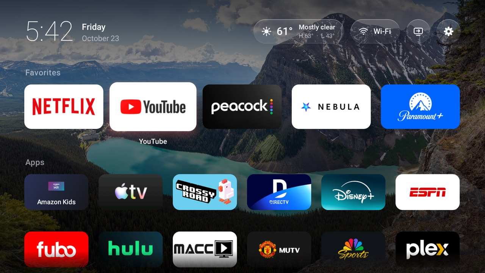
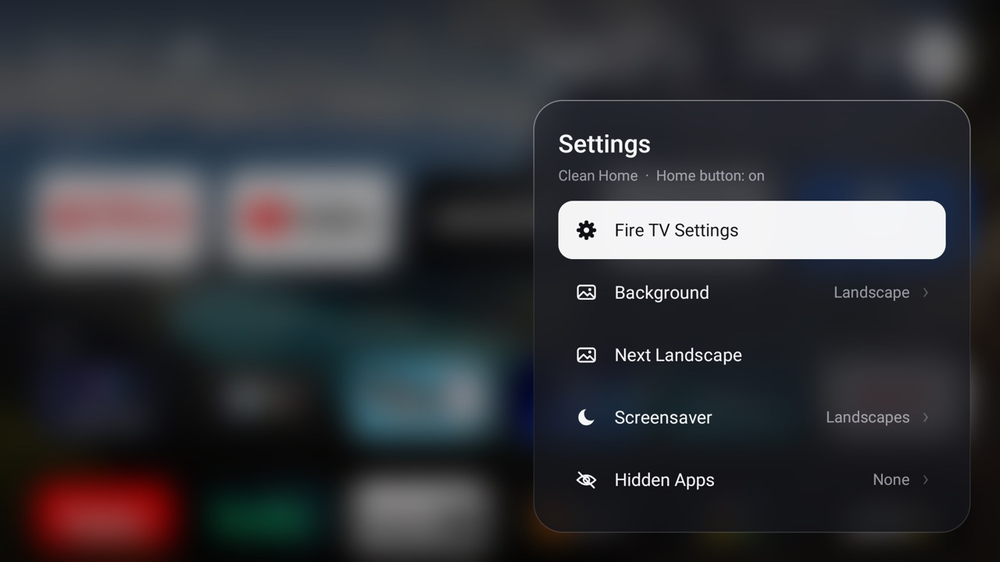
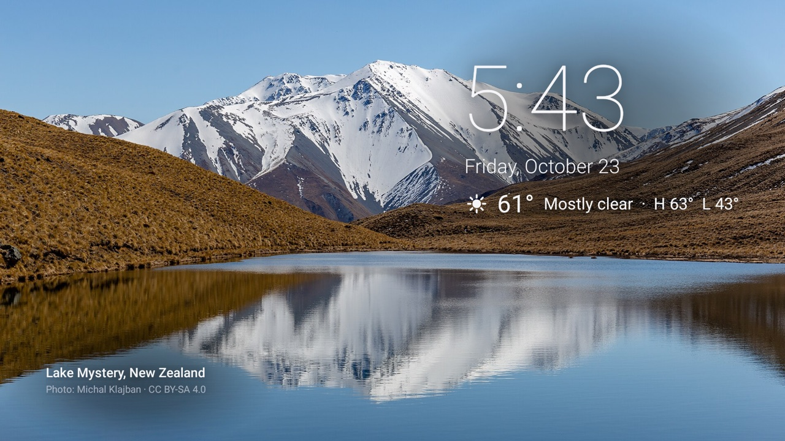

# Clean Home

A fast, ad-free home screen for **Amazon Fire TV smart TVs**, about 70 KB with no libraries.
It's a liquid-glass style launcher with live weather, landscape photo backgrounds and
a landscape screensaver. It takes over the Home button without root.

| Menus | Screensaver |
|---|---|
|  |  |

## What you get

- **Home screen:** clock, date, weather and Wi‑Fi status in a glass top bar. Below it
  are Favorites, Apps and Utilities as banner tiles that lift with a coloured glow on focus.
- **Backgrounds:** a landscape photo of the day, or an ambient glow tinted by the
  focused app.
- **Menus:** they spring out of the button that opened them over a frosted backdrop.
  Sub-pages slide in, and choices show a checkmark.
- **Inputs:** HDMI, antenna and composite in one menu, and choosing one goes straight to it.
- **Screensaver:** landscapes with a slow Ken Burns drift, plus time, date and weather.
  The text and credit move to a new corner each minute to protect against burn-in.
- **App management:** hold Select on a tile to favourite, move, hide it or open App Info.
- **Self-repair:** if Fire OS disables the Home service, the launcher re-enables it.
- **Debloat script:** disables Amazon's ad, tracking and telemetry packages. It keeps
  AirPlay, casting, inputs and Alexa voice.

Tested on Fire OS 7.7.1.7 (Android 9), on a 4K Fire TV smart TV (model `AFTDCT31`).

## How it works (the Fire OS part)

Fire OS doesn't let a third-party app become the home screen:

- The Home key never reaches apps.
- `set-home-activity` is ignored.
- For 5 seconds after Home, Android blocks ordinary apps from starting activities.

Clean Home works around this with an accessibility service:

1. When Amazon's home appears, the service immediately shows a cover overlay.
2. It then *clicks Clean Home's own tile in Amazon's app row*. Amazon's privileged
   launcher is exempt from the 5-second block, so Clean Home is back in about 0.6–1 s.

Switching inputs needs an Amazon-only permission, so the service drives Amazon's
Inputs row the same way.

Two more Fire OS quirks it handles:

- **Waking the TV:** Fire OS goes to its home before the screen turns off and simply
  resumes it on power-on, so the service also checks on every screen-on.
- **The app-row icon:** Amazon shows sideloaded apps' square icon on grey bars, not
  the TV banner. It replaces the icon of any HOME activity with a generic house, so
  the app-list entry is a separate alias. It also caches tile art per package name,
  even across uninstalls.

## Performance

| | Clean Home | Amazon launcher |
|---|---|---|
| Memory, on screen | ~85 MB | ~116 MB |
| Memory, behind an app | ~82–91 MB | ~111 MB |

How it stays light and smooth:

- Images are tile- or screen-sized and live only on the GPU (hardware bitmaps).
- There are no per-frame allocations.
- The home screen isn't drawn under opaque menus.
- There's a single opaque background layer, and blurs come from a tiny GPU snapshot.

Measured on the TV, fast D‑pad navigation runs at a median 11 ms per frame.

## Setup

You need a Mac or Linux machine on the same network as the TV.

1. **On the TV:** go to Settings → My Fire TV → About and click the device name 7 times.
   Then go to Developer Options and turn on **ADB debugging**.
2. **On your computer:** you need JDK 17 and the Android SDK build-tools 34, platform 34
   and `adb`. With Homebrew:
   `brew install openjdk@17 android-platform-tools android-commandlinetools`, then
   `sdkmanager "platforms;android-34" "build-tools;34.0.0"`.
3. `cp config.example.properties config.properties`, then set your weather location
   and the TV's IP address.
4. `adb connect <tv-ip>:5555`, and accept the prompt on the TV.
5. `./install.sh`
6. **One manual step:** in Amazon's home, open **More Apps**, highlight **Clean Home**,
   press **Menu (☰)** and choose **Move to front**. This makes the Home button instant.
7. Optional: `./debloat.sh` (undo with `./debloat.sh --restore`).

`build.sh` uses the bare SDK tools (aapt2, javac, d8, apksigner), with no Gradle.

## Credits

- Weather data by [Open-Meteo.com](https://open-meteo.com), CC BY 4.0.
- Landscapes are from [Wikimedia Commons Featured Pictures](https://commons.wikimedia.org/wiki/Commons:Featured_pictures).
  They're downloaded on the device, not redistributed here. Each photo's author and
  licence is shown on screen and listed in [`res/raw/landscapes.json`](res/raw/landscapes.json).

## License

MIT. See [LICENSE](LICENSE). Photos keep their own licences.
